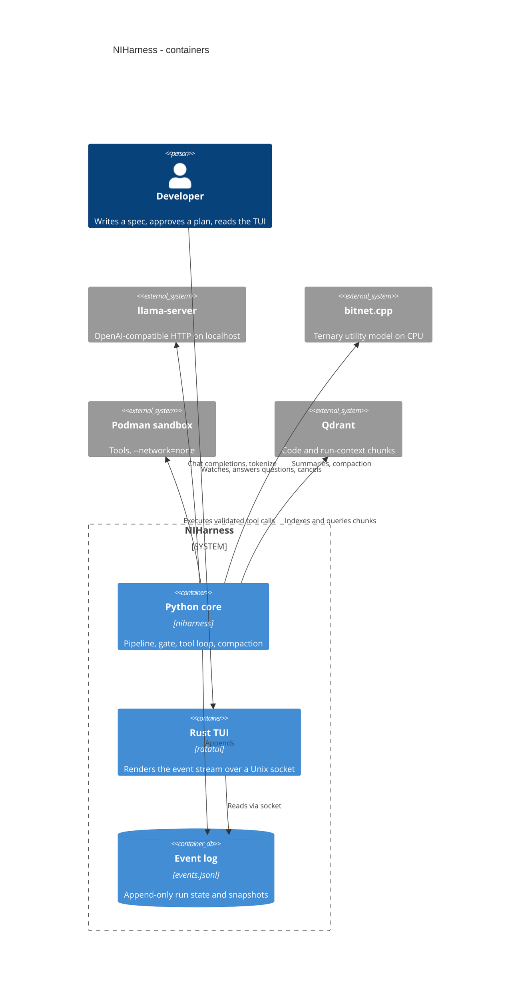
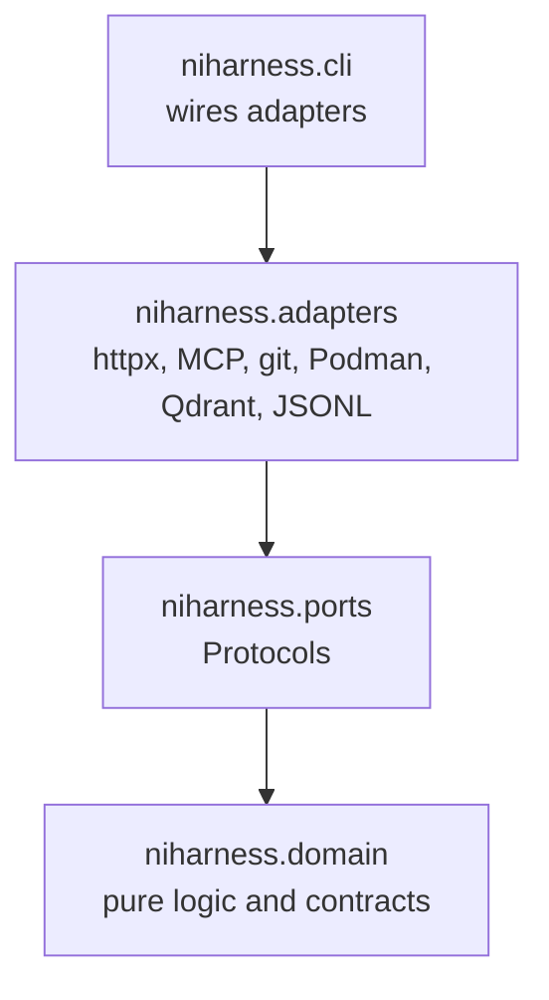
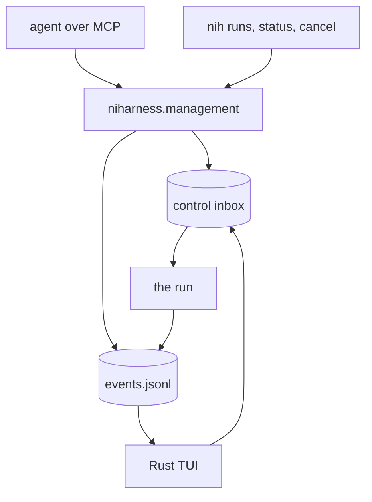

<!--
SPDX-FileCopyrightText: 2026 Mateusz Okulanis
SPDX-License-Identifier: GPL-3.0-or-later
-->

# Architecture

The harness is hexagonal, for one practical reason: the decisions worth testing
are the ones a model, a container or a network can make flaky. Keeping them in a
pure core means they are tested without any of those.

## The four layers

The rules, enforced by `uv run lint-imports`:

- `domain` imports nothing from `adapters`, `cli`, `config`, and no I/O library
  at all - not `httpx`, not `subprocess`, not even `socket`.
- `ports` depend on the domain only.
- Adapters do not import each other; the CLI composes them.

## Why the domain is pure, concretely

A pure domain is what lets these be plain unit tests:

| Decision | Tested with |
|---|---|
| Which gate commands run, in what order | a list of marker file names |
| Whether a tool call is allowed | a frozen allowlist and an argument dict |
| Whether a step is looping | a synthetic window of call records |
| What compaction drops | a window of items and a fake tokenizer |
| Where the pipeline goes next | a stage and an outcome |
| What a run's state is | a list of events |

No model, no container, no clock. The clock lives in the event sink, which is
also why replaying a log is deterministic: timestamps and sequence numbers are
data, not side effects.

## Who drives it

The harness is driven by whoever is there, through one surface:

`niharness.management` holds the registry, the plan store and the bounded views;
`niharness.cli` and the MCP server in `niharness.management.server` are two
callers that know nothing about each other. The layer may not import the CLI or
the tool server, and `lint-imports` checks that.

What that surface deliberately cannot do is write code, commit or run the gate -
see [ADR 0016](../adr/0016-the-management-surface.md), and
[Managing from an agent](../operations/managing-from-claude.md) for the
reasoning in full.

## Adding a subsystem

A new subsystem is six things in one change: a port Protocol, an adapter, a
contract test with recorded responses, a schema export if it introduces an
artifact, a documentation page, and an ADR. Anything less leaves a hole someone
else has to find.

See [ADR 0002](../adr/0002-hexagonal-architecture.md).
