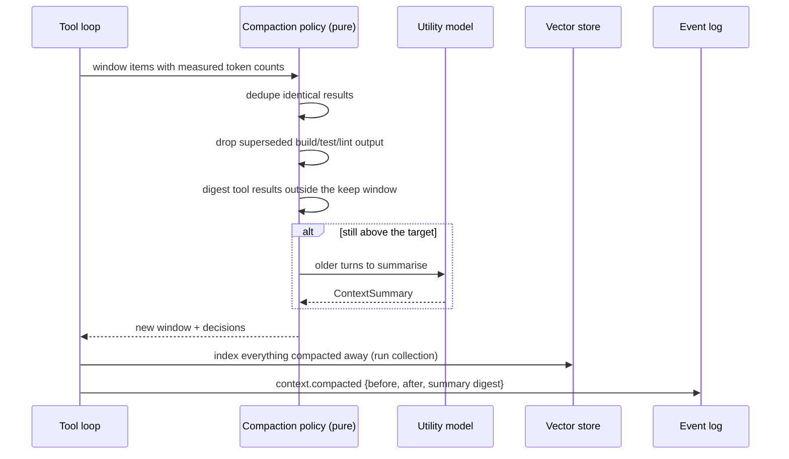

<!--
SPDX-FileCopyrightText: 2026 Mateusz Okulanis
SPDX-License-Identifier: GPL-3.0-or-later
-->

# Context management

The model's message window is a **derived view** over the event log, rebuilt
every turn. Compaction is a policy applied to that view, never an edit of the
log.

## Window layout

Priority one is never dropped; priority six goes first.

| Priority | Content | What compaction may do |
|---|---|---|
| 1 | prompt layers and the current task | nothing |
| 2 | `NOTES.md` pointer, open reviewer notes | nothing |
| 3 | the last N tool results, verbatim (N = 6 by default) | nothing while they are recent |
| 4 | assistant and user turns of the current step | fold into a summary when old |
| 5 | older tool results | replace with a one-line digest |
| 6 | older turns | replace with a `ContextSummary` |

A digest line keeps the identity of what was read, so the model can ask for it
again instead of guessing:

```text
read_file src/net.c: 412 lines, sha 3f9a4c1e2b7d8a05
```

## Triggers

Compaction runs when the window reaches `compact.threshold` (0.75 of the
context window by default), at every step boundary, or on demand from
`/compact` in the TUI and `nih compact <run-id>`.

## Procedure



Only the fourth step needs a model. Everything before it is deterministic, which
means most compactions cost nothing but a tokenizer call.

## Who applies it

The policy is pure, so something has to run it: `niharness.application.Window`.
It pairs every window item with the message that carries it, which is what keeps
the two in step - a digested item rewrites its message, a dropped item takes its
message with it - and it keeps insertion order, because a tool message has to
follow the assistant message that requested it
([ADR 0011](../adr/0011-message-assembly-is-an-application-concern.md)).

Before every model call the window measures itself through the `Tokenizer`
port, and compacts only when the measured fill reaches the threshold. Since the
policy is synchronous and the tokenizer is not, everything the policy could ask
to measure - each item's content and the digest line that might replace it - is
measured first, and the policy is handed a lookup. A miss is an error, never an
estimate.

The compactor model is optional. Without one, turns that the policy folded away
are replaced by a sentence saying how many there were and that they are still in
the event log. A stated gap beats a silent one.

## Invariants

These are property-tested with hypothesis, not merely asserted here:

- the window never grows,
- priority one and two survive every pass, byte for byte,
- the result is at or below the target, or the plan says `overflow`,
- the same window always produces the same plan.

## Recovery

Everything compacted away is indexed into the run's own collection in the vector
store, so `rag_query` can bring it back. Compaction loses a position in the
window, not information.

Token counts always come from the backend tokenizer. The compaction code cannot
estimate: it takes a `measure` function as an argument, and the adapter backs it
with `/tokenize`.
