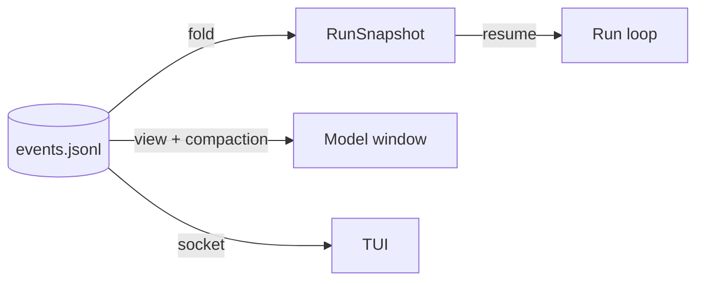

<!--
SPDX-FileCopyrightText: 2026 Mateusz Okulanis
SPDX-License-Identifier: GPL-3.0-or-later
-->

# Events

Run state is an append-only `events.jsonl` plus periodic snapshots. Nothing in
the harness mutates run state in place.

```json
{"seq":12,"ts":"2026-10-14T18:22:41.511Z","run_id":"8f21c0","step_id":"step-3",
 "body":{"type":"tool.called","call_id":"call_7","name":"read_file",
         "arguments":{"path":"src/net.c"},"arguments_digest":"3f9a4c1e2b7d8a05"}}
```

The envelope carries position and time; the body is one of the payloads in the
generated [event catalogue](../reference/events.md). Payloads are a discriminated
union on `type`, so adding an event cannot silently change an existing one.

## Who assigns what

| Field | Assigned by | Why |
|---|---|---|
| `body` | the domain | pure, deterministic, no clock |
| `seq`, `ts` | the event sink | the clock belongs at the edge |
| `run_id`, `step_id` | the sink, from context | correlation without threading them through the domain |

Appends are flushed and `fsync`ed before the call returns: the harness never
acts on an event it might lose.

## Derived, not stored



`nih status` is exactly that fold, and so is the TUI's state. Snapshots are an
optimisation so a resume need not replay from zero - never a second source of
truth.

## Schemas

`nih docs generate` exports the JSON Schema of the envelope, every artifact and
every tool argument set to `schemas/`. That directory is the contract with the
Rust TUI, which checks it at build time, so a schema change that would break the
viewer fails the gate instead of the viewer.
