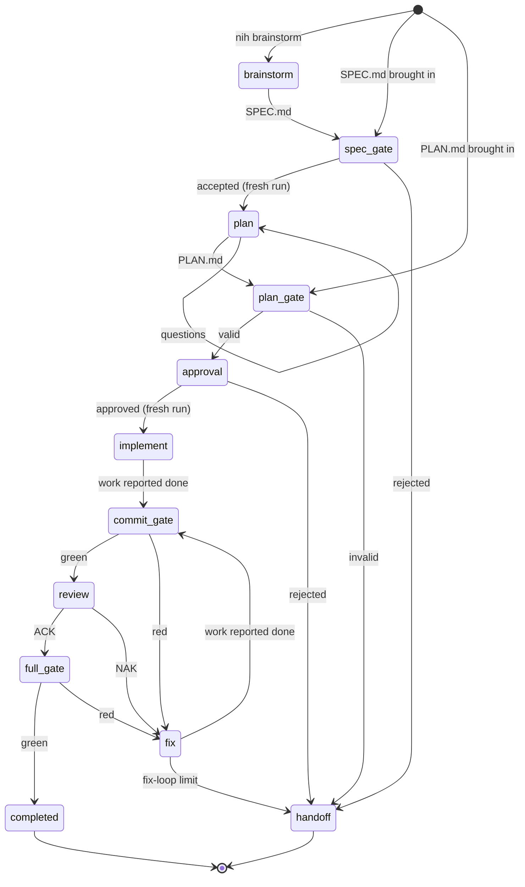

<!--
SPDX-FileCopyrightText: 2026 Mateusz Okulanis
SPDX-License-Identifier: GPL-3.0-or-later
-->

# Pipeline

Three entry points, one pipeline. The harness does not care whether a human, a
brainstorming session or another agent wrote the spec: everything passes the
same gates.

## Entry points

| Entry | Command | What it assumes |
|---|---|---|
| A | `nih brainstorm` | nothing; the model explores the codebase with you and drafts `SPEC.md` |
| B | `nih plan SPEC.md` | you (or another agent) wrote the spec |
| C | `nih plan import plan.md`, then `nih implement --plan PLAN.md` | you brought a finished plan and only want it executed |

B works today. A needs an interactive session loop; see the
[roadmap](../roadmap.md).

## The planning stage

`nih plan SPEC.md` runs it: the spec is validated offline, a worktree is made,
the planner reads the code with read-only tools, and what it writes becomes
`PLAN.md`.

What the planner writes is a `PlanDraft` - the tasks, in execution order, and
the questions the spec left open. The harness binds that draft to the spec's
digest to make a `Plan`, because the digest is the one field in the artifact
that is not a judgement: there is exactly one right value and the model could
only copy it. Every rule about the tasks themselves stays on `Plan` and fires
at the moment of binding, so a draft whose dependencies point forwards is
reported as the planning error it is, with the offending id named. See
[ADR 0026](../adr/0026-the-planner-writes-the-work-the-harness-binds-the-spec.md).

The spec gate's schema half runs before a model is started, and it is not a
formality: every acceptance criterion has to say how it is verified, and a
verification that only restates an intention is rejected. The reviewer half -
one ACK/NAK pass over the spec - is not built yet, so `spec.accepted` carries
`reviewed: false` rather than implying a review nobody ran.

Then the plan waits. `nih plan approve PLAN.md` records the decision by digest,
which is what `nih implement` runs. Approval is a human action and stays one;
`--approve` on the planning command is for the case where the same person is
doing both in one sitting.

`nih run SPEC.md` chains both halves and approves the plan for you - with one
exception. A plan whose `open_questions` are not empty is not implemented,
because the only stop `nih run` removes is the human reading of the plan, and a
planner that says it had to guess is exactly what that stop was for. The plan is
left approved and the questions printed, so `nih implement` is one command away
once you have read them; `--ignore-open-questions` says you have.

## Fresh runs at stage boundaries

Two transitions start a **new run**, seeded only with an artifact:

- spec accepted → `plan`, seeded with `SPEC.md`
- plan approved → `implement`, seeded with `PLAN.md`

Conversation history never crosses those boundaries. This is not an
optimisation, it is the forcing function: if a decision is not written into the
artifact, it does not survive, and the next stage cannot silently depend on
something it was told in passing.

## One task, one commit

A task is one logical change. The implementer works in a worktree on
`harness/run-<id>`, commits through [the gate](gate.md), and the reviewer then
re-runs the build and the tests itself - it does not trust the implementer's
claims. A `NAK` or a red gate sends the task to `fix`, bounded by
`max_revisions` (three by default); exceeding the bound hands the task back to
the human with the loop diagnostics in `NOTES.md`.

## The commit gate is observed, not re-run

`git_commit` is a tool, and the tool server runs the quick tier before it
commits. So the harness does not run the gate stage itself: it records HEAD
before a step and asks afterwards whether it moved. A commit exists if and only
if the gate passed. When one landed, the harness emits `vcs.committed` derived
from the diff, so the event log records it even though the harness did not make
it. See [ADR 0014](../adr/0014-review-starts-from-the-diff.md).

## Approval, cancellation and questions

Three things come from outside the run: a plan being approved, a run being
stopped, and the answers to a step's questions. All three arrive the same way -
as a request in the run's control inbox - and become events when the run acts
on them. A cancel lands at the next step boundary, never mid-tool, and leaves a
snapshot `nih resume` can pick up.

## Budgets

Every step carries a tool-call, token and wall-time budget, enforced by the
harness rather than requested from the model. Two calls before the tool budget
ends, the next model call is made with `tool_choice: none`, so a step finishes
with a written state instead of a severed tool call.

See the generated [configuration reference](../reference/config.md) for the
budget and policy keys, and [ADR 0005](../adr/0005-commit-is-the-gate.md) for
why the commit is the gate.
