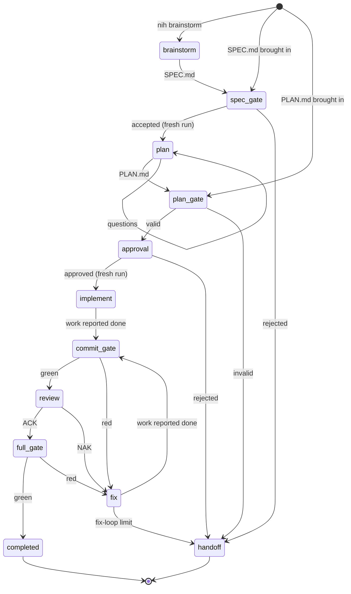

<!--
SPDX-FileCopyrightText: 2026 Mateusz Okulanis
SPDX-License-Identifier: GPL-3.0-or-later
-->

# Pipeline

Three entry points, one pipeline. The harness does not care whether a human, a
brainstorming session or another agent wrote the spec: everything passes the
same gates.

## Entry points

| Entry | Command | What it assumes |
|---|---|---|
| A | `nih brainstorm` | nothing; the model explores the codebase with you and drafts `SPEC.md` |
| B | `nih plan SPEC.md` | you (or another agent) wrote the spec |
| C | `nih plan import plan.md`, then `nih implement --plan PLAN.md` | you brought a finished plan and only want it executed |

## Fresh runs at stage boundaries

Two transitions start a **new run**, seeded only with an artifact:

- spec accepted → `plan`, seeded with `SPEC.md`
- plan approved → `implement`, seeded with `PLAN.md`

Conversation history never crosses those boundaries. This is not an
optimisation, it is the forcing function: if a decision is not written into the
artifact, it does not survive, and the next stage cannot silently depend on
something it was told in passing.

## One task, one commit

A task is one logical change. The implementer works in a worktree on
`harness/run-<id>`, commits through [the gate](gate.md), and the reviewer then
re-runs the build and the tests itself - it does not trust the implementer's
claims. A `NAK` or a red gate sends the task to `fix`, bounded by
`max_revisions` (three by default); exceeding the bound hands the task back to
the human with the loop diagnostics in `NOTES.md`.

## Budgets

Every step carries a tool-call, token and wall-time budget, enforced by the
harness rather than requested from the model. Two calls before the tool budget
ends, the next model call is made with `tool_choice: none`, so a step finishes
with a written state instead of a severed tool call.

See the generated [configuration reference](../reference/config.md) for the
budget and policy keys, and [ADR 0005](../adr/0005-commit-is-the-gate.md) for
why the commit is the gate.
