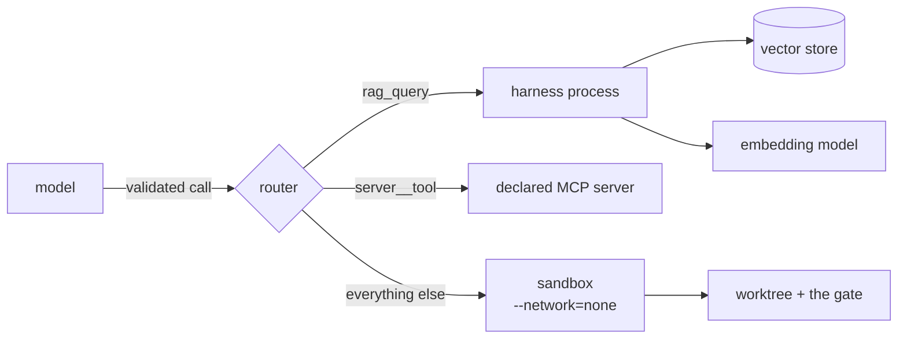

<!--
SPDX-FileCopyrightText: 2026 Mateusz Okulanis
SPDX-License-Identifier: GPL-3.0-or-later
-->

# Retrieval

`rag_query` turns a sentence into passages, each with a citation. It is in
every role's allowlist, because every role benefits from finding something by
what it means rather than by what it says.

```text
[1] datasheet.pdf pp. 12-13 (OCR)  score 0.694
Rozdzial 4: napiecie zasilania ukladu FPGA wynosi 1.8 V plus minus 5 procent.

[2] src/niharness/domain/gate.py:10-24 (gate_commands)  score 0.433
The quick gate runs format, lint, incremental build and unit tests.
```

The citation leads, so a model quoting a passage has the reference in front of
it and a person reading the event log can follow one. It is `grep`'s
complement, not its replacement: `grep` finds exact text, this finds the
passage that answers a question - including one asked in another language than
the document was written in, which is what bge-m3 is for.

## Three collections, searched by default

| Collection | Holds | Written by |
|---|---|---|
| `code` | the project's code, chunked by function and class | *not built yet* |
| `docs` | ingested [documents](documents.md), chunked by page | `nih ingest` |
| `run-<id>` | this run's compacted context | *not built yet* |

A query that names no collection searches all three. That default is the
reason [compaction](context.md) can drop a tool result without losing it: what
leaves the window is indexed under the run's own collection, and the model
recovers it by asking. Requiring it to name a collection first would mean it
has to know that, and it does not.

A collection nobody has written to yet does not exist, and the tool says so
rather than counting it as searched:

```text
1 match(es) in docs:
...

(not indexed yet, so not searched: code, run-7)
```

Naming a collection explicitly searches that one alone - and if it is absent,
that is reported as the typo it usually is, with the collections that do exist.

## Where it runs, and why that is not the sandbox

Every other tool a model may call runs inside the sandbox container, and the
container is started `--network=none`. The vector store is a service on the
host. Those two facts cannot both hold for a tool running in the container, and
of the two it is obvious which gives way: the network flag is a non-negotiable,
so **retrieval runs in the harness process** ([ADR
0021](../adr/0021-retrieval-runs-in-the-harness.md)).

That removes a capability from the sandbox rather than adding one. `rag_query`
reads no file, touches no worktree and cannot write; nothing it does needs the
confinement the sandbox exists to provide.



It is routed by name, so the domain still validates the call first, and the
call and its result are still events. The names a local provider answers are
*declared*, not discovered - so one cannot claim a tool the sandbox holds,
least of all `git_commit`.

## When retrieval is absent

Both halves are probed when a run starts: the store answers, and the embedding
model returns vectors of the width the collections were built at. On failure
the tool is **not offered** - it disappears from the model's tool list, the
run continues, and `nih implement` says so:

```text
  retrieval: off, so rag_query is not offered
    (POST http://127.0.0.1:8082/v1/embeddings: All connection attempts failed)
```

A tool that is offered and always fails is worse than one that was never
offered, because the model spends calls discovering that. The role's allowlist
is unchanged either way: an allowlist says what a role *may* do, not what this
host can do.

`nih tools` answers the same question before a run, and adds the part an
allowlist cannot:

```text
retrieval, in the harness process because the sandbox has no network:
  rag_query     http://127.0.0.1:6333 (qdrant 1.19.0), bge-m3 at 1024 dims
      code        not created yet, so nothing to find
      docs        412 chunk(s)
```

A configured store with empty collections answers every query with nothing and
looks, from the outside, exactly like a store that was never configured.

## The parts

| Piece | Where | Note |
|---|---|---|
| `Chunk`, `Hit`, what is searched, how results merge and read | `domain/rag.py` | pure; one `Chunk` type for code, documents and run context |
| `Embedder` | `ports/embedder.py` | separate from the chat port: an embedding model has no window, no tools, and one answer |
| `VectorStore` and its failures | `ports/vector_store.py` | the failures are in the port, because a caller must tell "nothing matched" from "nothing indexed" from "not running" |
| `/v1/embeddings` client | `adapters/openai_compat/embeddings.py` | the same protocol as inference; bge-m3 on a GPU and a BitNet embedding model on a CPU-only host differ by two lines of profile TOML |
| Qdrant over REST | `adapters/qdrant/` | five endpoints, `httpx`, no client library - every dependency has to be mirrored for the air gap |
| `rag_query` | `adapters/retrieval/` | a `LocalToolProvider`: the tool port plus the names it answers |

Indexing is a replacement, not an append: `forget(collection, path)` is part of
the store port, and `nih ingest` calls it before writing, so a revised document
does not leave its predecessor behind to be cited as current. See
[documents](documents.md#indexed-and-also-written-down).

Scores from one model over one metric are comparable across collections, so
merging is a sort. A chunk found in two collections is kept once, at its best
score - the same document indexed twice should not take two of the very few
slots a window can afford.

## What is not built yet

Two of the three collections have no writer. Indexing the project's code with
tree-sitter, and indexing compacted run context, are on
[the roadmap](../roadmap.md). Until then `rag_query` is useful for what
`nih ingest` put there, and honest about the rest.
