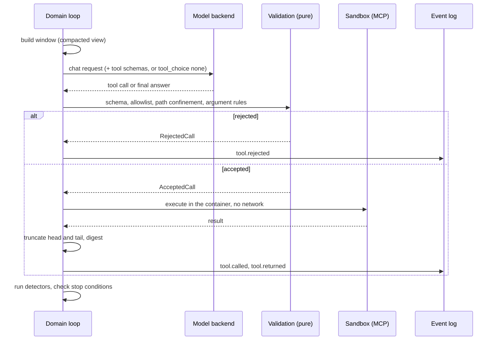

<!--
SPDX-FileCopyrightText: 2026 Mateusz Okulanis
SPDX-License-Identifier: GPL-3.0-or-later
-->

# Tool loops

A step that uses tools is a bounded ReAct loop owned by the domain. One
iteration:



The sandbox side of that picture is this project's own MCP server
(`niharness.toolserver`): it offers exactly the tools above, resolves every path
against the worktree root, and holds the gate, so `git_commit` is an attempt
rather than a write. See [Sandbox](../operations/sandbox.md).

Three of those tools answer from a language server rather than from the
filesystem - `find_symbol`, `find_references` and `file_outline` - which is
how a definition costs a line instead of a page. See
[language servers](../operations/language-servers.md).

A project may add MCP servers of its own. Their tools go through the same loop
and the same validation, addressed as `<server>__<tool>` so nothing they
advertise can be mistaken for the tools above, and with the schema the server
advertised standing in for the argument model the harness does not have. The
rules, and what such a server still cannot do, are in
[declared MCP servers](../operations/mcp-servers.md).

## The artifact's schema belongs to the closing turn

A step declares the artifact that ends it - a `FinalAnswer`, a `Verdict` - and
that declaration is a constraint on the model's output. It is applied only on a
turn that cannot call a tool.

Demanding it while tools are offered is a contradiction: a tool call does not
satisfy the artifact's schema, so the model is told to produce something it is
simultaneously forbidden to produce. A real backend makes the contradiction
loud - llama.cpp installs one grammar for the tool-call syntax and another for
the schema, and refuses the request with `failed to parse grammar` - but the
contradiction was the harness's, which is why this is a rule and not a
workaround for a backend.

The closing turn already exists: it is the one forced finalisation produces,
with `tool_choice: none`. That is where the artifact is demanded.

## Diffs a model actually writes

`apply_patch` is the only way anything changes, and a model writes a diff by
hand. It gets the *change* right far more often than the paperwork, and three
clerical mistakes account for nearly all of the failures:

| What the model writes | What git wants | What the harness does |
|---|---|---|
| `--- src/a.py` (no `a/`) | one component to strip | retries with `-p0` |
| `@@ -1,9 +1,9 @@` over a two-line hunk | counts that match | retries with `--recount` |
| `--- src/new.py` for a new file | `--- /dev/null` | rewrites the header, and says so |

None of that changes what a diff may do: the content still has to match the
file, so a diff whose context is not in the worktree is still refused, and the
file is still created where the diff says - a repaired header has to agree with
the strip level, or the file lands one directory too high.

The refusals say what was wrong rather than quoting git. `corrupt patch at line
8` becomes the line itself and the rule it breaks, because the model is the one
that has to fix it:

```text
the diff does not apply:
[as written] error: corrupt patch at <stdin>:8
line 8 is 'from . import greet': inside a hunk every line must start with a
space, a '+' or a '-'. Text with no prefix ends the hunk and makes the rest
unreadable.
```

A tool that silently repaired its caller would teach it nothing, so a repair is
reported in the successful result too.

## Stop conditions

- a final answer with the Definition of Done checklist filled,
- any budget exhausted - tool calls, tokens or wall time,
- a detector escalated to step failure,
- `run.cancelled`.

## Detectors

Pure functions over the step's window of call records. Thresholds live in
`harness.toml` under `[loop]`.

| Pathology | Signal | Default |
|---|---|---|
| exact repeat | same tool, identical arguments digest | 2 within the last 5 calls |
| state cycle | the worktree digest revisits an earlier state (A → B → A) | 1 revisit |
| progress stall | consecutive calls that changed nothing and returned a known result | 8 |
| gate thrash | the same normalised [failure signature](gate.md) returns | 3 |
| invalid calls | schema or allowlist violations in a row | 3 |
| degenerate output | an n-gram repeats in the assistant stream | 8-gram, 4 times |

A detector needs **both** halves of the signal where that matters: eight calls
that change nothing are only a stall if the results were also already seen,
because reading eight new files changes nothing and is perfectly good work.

## Intervention ladder

Each firing climbs exactly one rung, and the rung is an event
(`loop.intervention`):

1. **Synthetic tool result**, no model call: "this exact call already ran, here
   is the digest of its result, choose a different action".
2. **Reflection turn**: the model must say what it tried, why each attempt
   failed, and one approach that differs - no tool call is accepted in that
   turn.
3. **Rollback and restart** the step from the last green commit, with a
   `ContextSummary` of the failed attempts so they are not repeated.
4. **Step failure**: the task goes back to the human with the diagnostics in
   `NOTES.md`.

## Who performs the actions

The loop is a pure state machine: `next_action(state)` returns what should
happen, and each `observe_*` folds the outcome back into a new state **plus the
events to append**. The executor - `niharness.application.StepRunner` - does
exactly what it is told and nothing else: it calls the model, runs the tool in
the sandbox, rolls the worktree back, and appends the events it is handed.

That split is why the ladder above is testable without a model or a container,
and why the event stream cannot drift from the state that produced it. See
[ADR 0009](../adr/0009-the-tool-loop-is-a-pure-state-machine.md) and
[ADR 0010](../adr/0010-an-application-layer.md).

## Why it is tested this way

Detectors are unit-tested on synthetic windows and property-tested for
determinism: the same window must always yield the same verdict. Loop incidents
per task is also a benchmark metric, which makes "this model loops" a measurable
claim rather than an impression.
