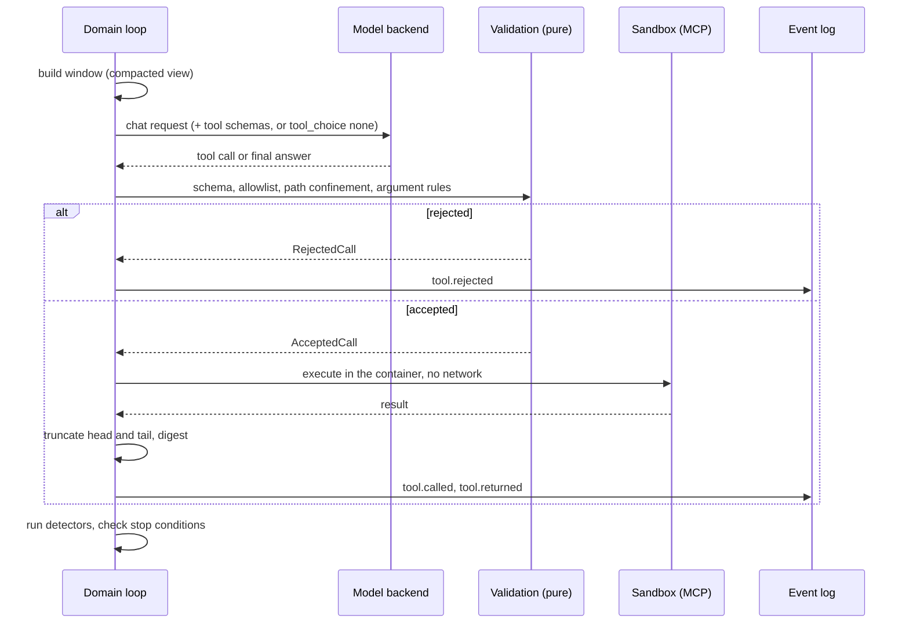

<!--
SPDX-FileCopyrightText: 2026 Mateusz Okulanis
SPDX-License-Identifier: GPL-3.0-or-later
-->

# Tool loops

A step that uses tools is a bounded ReAct loop owned by the domain. One
iteration:

## Stop conditions

- a final answer with the Definition of Done checklist filled,
- any budget exhausted - tool calls, tokens or wall time,
- a detector escalated to step failure,
- `run.cancelled`.

## Detectors

Pure functions over the step's window of call records. Thresholds live in
`harness.toml` under `[loop]`.

| Pathology | Signal | Default |
|---|---|---|
| exact repeat | same tool, identical arguments digest | 2 within the last 5 calls |
| state cycle | the worktree digest revisits an earlier state (A → B → A) | 1 revisit |
| progress stall | consecutive calls that changed nothing and returned a known result | 8 |
| gate thrash | the same normalised [failure signature](gate.md) returns | 3 |
| invalid calls | schema or allowlist violations in a row | 3 |
| degenerate output | an n-gram repeats in the assistant stream | 8-gram, 4 times |

A detector needs **both** halves of the signal where that matters: eight calls
that change nothing are only a stall if the results were also already seen,
because reading eight new files changes nothing and is perfectly good work.

## Intervention ladder

Each firing climbs exactly one rung, and the rung is an event
(`loop.intervention`):

1. **Synthetic tool result**, no model call: "this exact call already ran, here
   is the digest of its result, choose a different action".
2. **Reflection turn**: the model must say what it tried, why each attempt
   failed, and one approach that differs - no tool call is accepted in that
   turn.
3. **Rollback and restart** the step from the last green commit, with a
   `ContextSummary` of the failed attempts so they are not repeated.
4. **Step failure**: the task goes back to the human with the diagnostics in
   `NOTES.md`.

## Why it is tested this way

Detectors are unit-tested on synthetic windows and property-tested for
determinism: the same window must always yield the same verdict. Loop incidents
per task is also a benchmark metric, which makes "this model loops" a measurable
claim rather than an impression.
