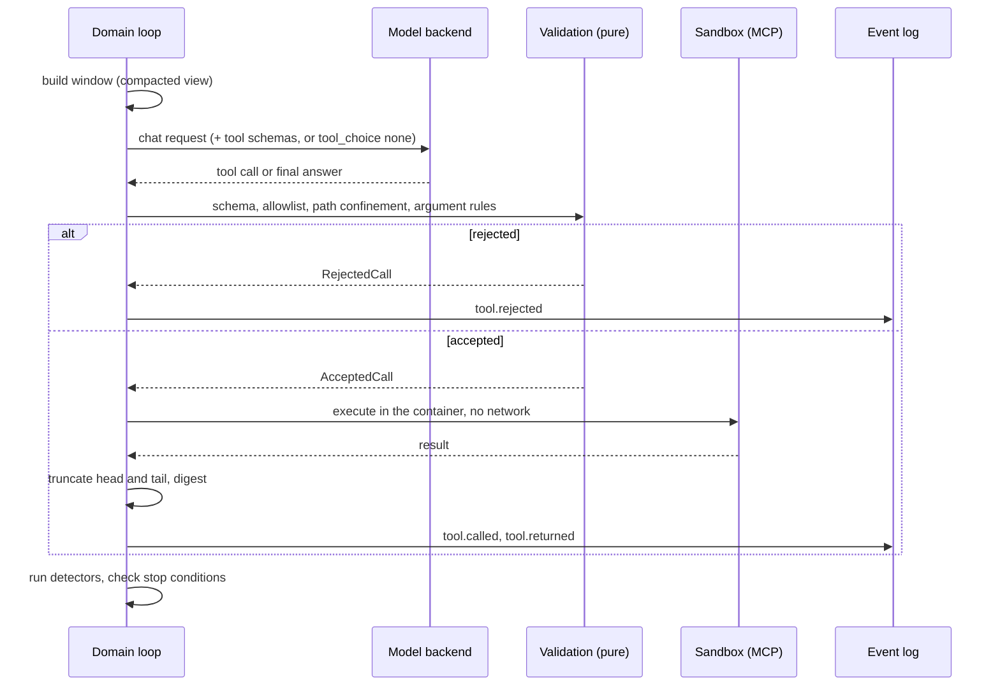

<!--
SPDX-FileCopyrightText: 2026 Mateusz Okulanis
SPDX-License-Identifier: GPL-3.0-or-later
-->

# Tool loops

A step that uses tools is a bounded ReAct loop owned by the domain. One
iteration:



The sandbox side of that picture is this project's own MCP server
(`niharness.toolserver`): it offers exactly the tools above, resolves every path
against the worktree root, and holds the gate, so `git_commit` is an attempt
rather than a write. See [Sandbox](../operations/sandbox.md).

Three of those tools answer from a language server rather than from the
filesystem - `find_symbol`, `find_references` and `file_outline` - which is
how a definition costs a line instead of a page. See
[language servers](../operations/language-servers.md).

A project may add MCP servers of its own. Their tools go through the same loop
and the same validation, addressed as `<server>__<tool>` so nothing they
advertise can be mistaken for the tools above, and with the schema the server
advertised standing in for the argument model the harness does not have. The
rules, and what such a server still cannot do, are in
[declared MCP servers](../operations/mcp-servers.md).

## The artifact's schema belongs to the closing turn

A step declares the artifact that ends it - a `FinalAnswer`, a `Verdict` - and
that declaration is a constraint on the model's output. It is applied only on a
turn that cannot call a tool.

Demanding it while tools are offered is a contradiction: a tool call does not
satisfy the artifact's schema, so the model is told to produce something it is
simultaneously forbidden to produce. A real backend makes the contradiction
loud - llama.cpp installs one grammar for the tool-call syntax and another for
the schema, and refuses the request with `failed to parse grammar` - but the
contradiction was the harness's, which is why this is a rule and not a
workaround for a backend.

The closing turn already exists: it is the one forced finalisation produces,
with `tool_choice: none`. That is where the artifact is demanded.

## Two ways to change a file

`replace_in_file` is the one to reach for: `find` is text copied out of the
file, `replace` is what goes in its place, and the passage has to occur exactly
once. An **empty** `find` creates the file, with `replace` as its whole
content ([ADR 0025](../adr/0025-creation-is-an-edit-with-nothing-to-find.md)) -
measured, because the one writing task a 4B failed on the L1 suite was the one
where creation forced it into a hand-written diff. The harness locates it, writes the file, and **computes the diff**, which
is what the reviewer and the commit see. There are no hunk headers to count,
so they cannot be counted wrong ([ADR 0022](../adr/0022-an-edit-located-by-its-own-text.md)).

Its refusals are about the passage, and each has an answer:

| What happened | What the model is told |
|---|---|
| the passage differs only in whitespace | the exact bytes from the file, to copy |
| the passage is not there at all | the closest line in the file, and that `read_file`'s numbers are not in it |
| it occurs more than once | how many times, and to include a unique line around it |
| `find` equals `replace` | that the edit would change nothing |
| an empty `find` on a file that exists | that it does not say what to change; overwriting is what the size cap exists to bound |

`apply_patch` remains for creating a file and for a change spread over several
places at once. It takes a unified diff, which a model writes by hand.

## Diffs a model actually writes

A model gets the *change* right far more often than the paperwork, and a
handful of clerical mistakes account for nearly all of the failures. Every row
below is a diff a live model actually produced:

| What the model writes | What git wants | What the harness does |
|---|---|---|
| `--- src/a.py` (no `a/`) | one component to strip | retries with `-p0` |
| `@@ -1,9 +1,9 @@` over a two-line hunk | counts that match | retries with `--recount` |
| `--- src/new.py` for a new file | `--- /dev/null` | rewrites the header, and says so |
| `--- a/dev/null` | `--- /dev/null` | the same rewrite: the `a/` convention does not apply to `/dev/null` |
| a last line with no newline | every line terminated | terminates it, and says so |
| `     1  def add(x, y):` as context | the file's own text | strips the margin, and says where it came from |
| every line prefixed with a space | `+` for the lines being added | refuses: it would apply cleanly and change nothing |
| `+ VALUE = 1` on its own | headers and a hunk | refuses, naming the three lines that are missing |
| the same patch twice | - | answers "already applied", because the worktree is in the state that was asked for |
| a diff against a file that exists | - | names `replace_in_file` and how to call it, because that is the shorter road |

Two of those are the harness's own fault and the last is its own doing.
`read_file` numbers its answer, which is what makes it readable; a model that
writes a diff from what it read carries the numbers into the context, where
they are not in the file, so every line mismatches and git blames a hunk
header. The harness put them there, so it takes them off.

A context-only diff is the one that has to be *refused* rather than repaired,
and it is the only entry here where applying it would have succeeded. git
accepts it, changes nothing, and the model walks into the gate believing it
wrote the change.

None of that changes what a diff may do: the content still has to match the
file, so a diff whose context is not in the worktree is still refused, and the
file is still created where the diff says - a repaired header has to agree with
the strip level, or the file lands one directory too high. A repair is only
kept when the repaired diff applies; a wrong guess is indistinguishable from
the diff that already did not apply.

The refusals say what was wrong rather than quoting git. `corrupt patch at line
8` becomes the line itself and the rule it breaks, because the model is the one
that has to fix it:

```text
the diff does not apply:
[as written] error: corrupt patch at <stdin>:8
line 8 is 'from . import greet': inside a hunk every line must start with a
space, a '+' or a '-'. Text with no prefix ends the hunk and makes the rest
unreadable.
```

A tool that silently repaired its caller would teach it nothing, so a repair is
reported in the successful result too.

The last row is the one that matters most in practice. A model that cannot tell
"this patch is wrong" from "this patch is already in" re-sends it: observed on a
live run, three times in a row, until the detectors ended the step. git can tell
the two apart - if the *reverse* patch applies, the change is already there -
so the harness answers that the worktree is in the state the model asked for,
and the step carries on.

## Stop conditions

- a final answer with the Definition of Done checklist filled,
- any budget exhausted - tool calls, tokens or wall time,
- a detector escalated to step failure,
- `run.cancelled`.

## Detectors

Pure functions over the step's window of call records. Thresholds live in
`harness.toml` under `[loop]`.

| Pathology | Signal | Default |
|---|---|---|
| exact repeat | same tool, identical arguments digest | 2 within the last 5 calls |
| state cycle | the worktree digest revisits an earlier state (A → B → A) | 1 revisit |
| progress stall | consecutive calls that changed nothing and returned a known result | 8 |
| gate thrash | the same normalised [failure signature](gate.md) returns | 3 |
| invalid calls | schema or allowlist violations in a row | 3 |
| degenerate output | an n-gram repeats in the assistant stream **or in a tool call's arguments** | 8-gram, 4 times |

A detector needs **both** halves of the signal where that matters: eight calls
that change nothing are only a stall if the results were also already seen,
because reading eight new files changes nothing and is perfectly good work.

## A claim the harness can check, it checks

A `Verdict` asserts two things the harness can verify exactly: that the build
passed and that the tests passed. §4 has always said the reviewer re-runs both
itself and does not trust the implementer's claims. Nothing checked whether it
did.

So a verdict whose claims are not backed by its *own* step is sent back once,
with the claim named and tools still on the table:

> That verdict claims evidence this step does not have: run_tests was never
> called in this step. Run it yourself and answer again. A reviewer that takes
> a claim on trust is the thing a reviewer is for.

Three properties keep this from becoming a wall:

- **Asked once.** A model that answers unbacked a second time has its verdict
  accepted. A step that cannot end is worse than an unearned claim, and the
  claim is in the log either way.
- **Tools stay on.** Being told to run the tests on a turn that cannot call a
  tool is exactly the shape of refusal this project keeps removing, so the
  retry re-enables them.
- **Not inside forced finalisation.** When the budget is down to the
  finalisation margin there is nothing left to run anything with, so the
  verdict stands and the log records what was claimed.

The harness never touches the decision. A review is the model's judgement to
make; what the harness refuses is to record evidence nobody gathered.

It was found by measuring. On the first L2 run a 4B ACKed a change after two
tool calls, neither of them `run_tests`, while asserting that the tests
passed - see [the methodology](../benchmarks/methodology.md) and
[ADR 0027](../adr/0027-a-review-case-is-a-tree-and-its-verdict-must-be-earned.md).

### The implementer makes the same claim

An answer that reports the task **done** claims a commit: the Definition of
Done says the change is one logical change in one commit, and the gate is
`git_commit`. That is checkable against the same log - either a `git_commit`
call in this step came back green, or nothing was committed and the gate has
not run.

> This answer reports the task done, and git_commit was never called in this
> step, so nothing was committed. The gate has not run, so by this project's
> rules the work has not happened. Commit it with `git_commit`, which is the
> gate - or answer again with the checklist showing what is not done, and why,
> in NOTES.md.

The same three properties hold, and two more matter here:

- **An incomplete checklist is not touched.** A model saying it is not done is
  being honest, and the handoff that follows is the designed ending. Only a
  step claiming completion is asked about the commit.
- **Only a step that owes a commit.** `LoopConfig.requires_commit` is declared
  by the caller, and the pipeline sets it for implement and fix alone. A
  benchmark task that edits a file to prove it can call `replace_in_file` has
  finished when the file is edited; demanding a commit of it would measure a
  pipeline nobody runs.

This one was also found by measuring, and the cost of not checking it was
visible: on the first L3 passes two of three tasks per pass had work the
hidden tests **accept**, sitting uncommitted, while the step reported a
complete checklist. The commit gate then found nothing had landed and the fix
loop spent its revisions on work that was already right.

## Intervention ladder

A degenerate response is the one the loop **refuses** outright rather than
escalating over: it is recorded as an invalid call, the model is told the
answer repeated itself, nothing is dispatched, and - the part that is easy to
miss - the turn never enters the window. The executor asks before it records,
because refusing afterwards leaves the junk in the window and the next token
count fails on it. Logging it and carrying on -
which is what the code did until a live run proved otherwise - means the
arguments arrive truncated mid-string, the window carries the junk, and the
next tokenizer call fails on it. That ended a benchmark run rather than a step.
Checking the prose alone also missed it: the repetition was inside a
`replace_in_file` argument and `content` was empty.

Each firing climbs exactly one rung, and the rung is an event
(`loop.intervention`):

1. **Synthetic tool result**, no model call. For a call that succeeded: "this
   exact call already ran, here is the digest of its result, choose a
   different action". For one that was **refused**, the refusal's own words
   again - because a hash is nothing a model can act on, and the reason has
   not changed.

    That second case is measured rather than reasoned. On the 20-task L1 suite
    every one of nine failing tasks ended with the same two interventions, and
    the pattern underneath was always the same: a tool refuses with a message
    that says exactly what to do, the model re-sends the identical call, and
    the ladder stops the step. The refusal's advice was already in the window
    and the repeat handed over a digest. It now hands back the advice.
2. **Reflection turn**: the model must say what it tried, why each attempt
   failed, and one approach that differs - no tool call is accepted in that
   turn, and **no artifact is demanded of it either**. The two are different
   questions and were one: the step's schema used to be attached to any turn
   that withheld tools, so this rung told a model to answer in plain prose
   with a request whose grammar forced a `FinalAnswer`. It complied with the
   grammar, put its list of attempts in the checklist with every item
   unticked, and the step ended on an incomplete Definition of Done. The rung
   meant to get a model unstuck was handing its task to a human. A call
   proposed on this turn is still a call the detectors see, because a model
   that answers "what else could you try" by re-sending the same call has
   earned the next rung.
3. **Rollback and restart** the step from the last green commit, with a
   `ContextSummary` of the failed attempts so they are not repeated.
4. **Step failure**: the task goes back to the human with the diagnostics in
   `NOTES.md`.

## Who performs the actions

The loop is a pure state machine: `next_action(state)` returns what should
happen, and each `observe_*` folds the outcome back into a new state **plus the
events to append**. The executor - `niharness.application.StepRunner` - does
exactly what it is told and nothing else: it calls the model, runs the tool in
the sandbox, rolls the worktree back, and appends the events it is handed.

That split is why the ladder above is testable without a model or a container,
and why the event stream cannot drift from the state that produced it. See
[ADR 0009](../adr/0009-the-tool-loop-is-a-pure-state-machine.md) and
[ADR 0010](../adr/0010-an-application-layer.md).

## Why it is tested this way

Detectors are unit-tested on synthetic windows and property-tested for
determinism: the same window must always yield the same verdict. Loop incidents
per task is also a benchmark metric, which makes "this model loops" a measurable
claim rather than an impression.
